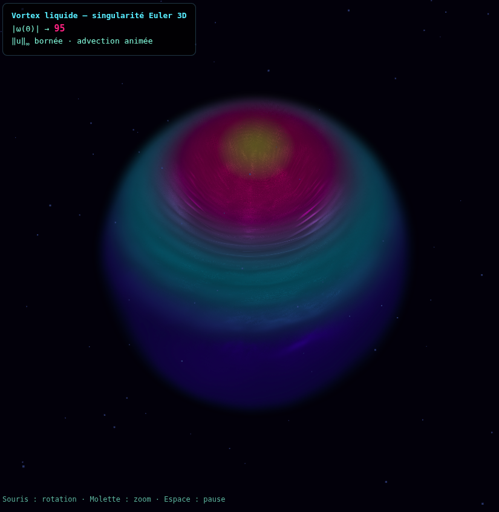
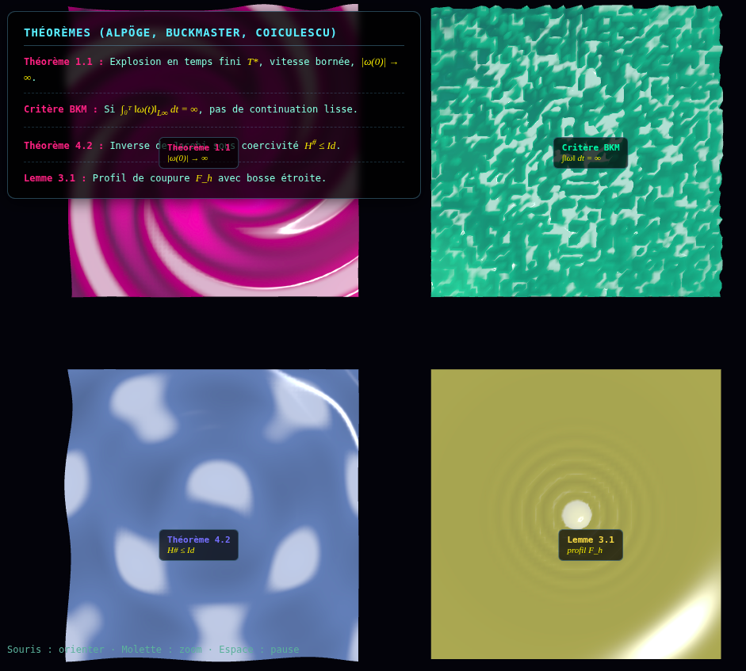

# Formation de singularité en temps fini pour les équations d'Euler 3D

**Auteurs du papier / Paper Authors:** Levent Alpöge, Tristan Buckmaster, Matei P. Coiculescu
**Visualisations & Code / Visualizations & Code:** Thibaut Lombard ([Lombard Web Services](https://github.com/Lombard-Web-Services))
**Licence / License:** [MIT](https://opensource.org/licenses/MIT)

---

## 🇫🇷 Français

### À propos
Ce dépôt contient une série de visualisations interactives en 3D (WebGL/Three.js) conçues pour illustrer les résultats du papier de recherche **« Finite-Time Singularity Formation for the Three-Dimensional Euler Equations »** (Alpöge, Buckmaster, Coiculescu). 

Le papier démontre qu'il existe des données initiales lisses pour l'équation d'Euler 3D incompressible (sans force extérieure) dont la solution développe une singularité (explosion) en temps fini : la vorticité tend vers l'infini en un point, tandis que la vitesse reste bornée. Les visualisations ci-dessous sont des interprétations graphiques pédagogiques, basées sur les concepts mathématiques du papier (ondes de Craik-Criminale, critère BKM, etc.).

### Visualisations interactives

Cliquez sur les liens ou les images pour lancer les visualisations dans votre navigateur (nécessite WebGL).

---

#### 1. Vorticité — Particules & Lignes de Flux

- **Fichier :** `Vorticité-Particules-lignes-de-flux.html`
- **Description :** Un rendu fluide sous forme de nuage de particules lumineuses combiné à des lignes de courant lisses et continues. Le vortex concentre sa vorticité près du pôle « origine », illustrant la croissance locale de `|ω(0)|` tandis que la vitesse globale reste bornée par un clamp (Théorème 1.1). La couleur évolue du cyan vers le magenta/jaune à l'approche de la singularité.

---

#### 2. Vorticité — Modèle Sphérique

- **Fichier :** `Vorticité.html`
- **Description :** Une visualisation abstraite et géométrique présentant une sphère filaire avec des lignes hélicoïdales (tubes) enroulées autour, convergeant vers le pôle nord. Ce modèle illustre la géométrie des ondes de Craik-Criminale et la concentration de la vorticité vers un point singulier, accompagné d'un halo lumineux réactif.

---

#### 3. Vortex et Singularité Locale (Liquide & Particules)

- **Fichier :** `vortex-et-singularite-locale.html`
- **Description :** Un rendu volumétrique de fluide utilisant un grand nombre de particules (9000) pour simuler un liquide dense. Le champ de vitesse analytique combine une rotation tangentielle (vorticité concentrée) et une attraction méridienne vers le pôle. Des traînées de courant sont affichées, mettant en évidence la convergence et la turbulence autour de l'axe de la singularité.

---

#### 4. Vortex Liquide — Singularité Euler 3D (Net & Animé)

- **Fichier :** `Vortex-liquide-Singularite-euler-3D.html`
- **Description :** Un rendu de fluide net et contrasté utilisant un shader de raymarching optimisé. Le vortex présente des bandes de vorticité animées qui tournent et s'élèvent vers le pôle. L'absorption de Beer-Lambert et l'éclairage dynamique donnent un effet de volume réaliste, où la singularité centrale brille intensément.

---

#### 5. Liquide sur plan Rectangulaire & Théorèmes, Résultats Clés

- **Fichier :** `resultats_alpoge-buckmaster-coiculescu..html`
- **Description :** Une surface d'eau rectangulaire interactive avec des vagues (vertex shader) et des effets de réflexion/réfraction (fragment shader simulant le raytracing). Un HUD superposé affiche les théorèmes clés du papier (Théorème 1.1, Critère de Beale-Kato-Majda, Théorème 4.2, Condition de non-explosion) tandis qu'une étiquette dynamique indique `|ω(0)| → ∞`.

---

#### 6. Visualisation des 4 Théorèmes (Split Screen)

- **Fichier :** `theoreme_alpoge-buckmaster-coiculescu.html`
- **Description :** Une scène divisée en quatre quadrants, chacun illustrant un concept mathématique spécifique par une surface liquide animée :
  1. Le puits de singularité (Théorème 1.1) avec attraction et tourbillon.
  2. Le chaos de l'intégrale BKM (Critère de Beale-Kato-Majda) avec des ondes désordonnées.
  3. La stabilité de l'inverse de Jacobi (Théorème 4.2) avec des ondulations régulières.
  4. Le profil de coupure `F_h` (Lemme 3.1) avec une bosse centrale étroite.

---

### 🚀 Lancer localement
Aucune installation n'est requise. Ouvrez simplement les fichiers `.html` dans un navigateur moderne (Chrome, Firefox, Edge, Safari) supportant WebGL.

### Crédits
- **Recherche originale :** Basé sur le document de **Levent Alpöge, Tristan Buckmaster, and Matei P. Coiculescu**.
- **Développement des visualisations :** Thibaut Lombard pour [Lombard Web Services](https://github.com/Lombard-Web-Services).
- **Licence :** MIT.

---
# Finite-Time Singularity Formation for the 3D Euler Equations

## 🇬🇧 English

### About
This repository contains a series of interactive 3D visualizations (WebGL/Three.js) designed to illustrate the results of the research paper **"Finite-Time Singularity Formation for the Three-Dimensional Euler Equations"** (Alpöge, Buckmaster, Coiculescu).

The paper proves that there exist smooth initial data for the 3D incompressible Euler equations (without external forcing) whose solution develops a singularity (blow-up) in finite time: the vorticity tends to infinity at a point, while the velocity remains bounded. The visualizations below are pedagogical graphical interpretations, based on the mathematical concepts of the paper (Craik-Criminale waves, BKM criterion, etc.).

### Interactive Visualizations

Click on the links or images to launch the visualizations in your browser (WebGL required).

---

#### 1. Vorticity — Particles & Streamlines

- **File:** `Vorticité-Particules-lignes-de-flux.html`
- **Description:** A fluid rendering using a cloud of glowing particles combined with smooth, continuous streamlines. The vortex concentrates its vorticity near the "origin" pole, illustrating the local grow

---

#### 2. Vorticity — Spherical Model

- **File:** `Vorticité.html`
- **Description:** An abstract, geometric visualization featuring a wireframe sphere with helical lines (tubes) wrapped around it, converging toward the north pole. This model illustrates the geometry of Craik-Criminale waves and the concentration of vorticity toward a singular point, accompanied by a reactive light halo.

---

#### 3. Vortex and Local Singularity (Liquid & Particles)

- **File:** `vortex-et-singularite-locale.html`
- **Description:** A volumetric fluid rendering using a large number of particles (9000) to simulate a dense liquid. The analytical velocity field combines tangential rotation (concentrated vorticity) and meridional attraction toward the pole. Streamlines are displayed, highlighting convergence and turbulence around the singularity axis.

---

#### 4. Liquid Vortex — Euler 3D Singularity (Crisp & Animated)

- **File:** `Vortex-liquide-Singularite-euler-3D.html`
- **Description:** A crisp and contrasted fluid rendering using an optimized raymarching shader. The vortex features animated vorticity bands that rotate and rise toward the pole. Beer-Lambert absorption and dynamic lighting give a realistic volume effect, with the central singularity glowing intensely.

---

#### 5. Rectangular Liquid & Theorems, Key Results

- **File:** `resultats_alpoge-buckmaster-coiculescu..html`
- **Description:** An interactive rectangular water surface with waves (vertex shader) and reflection/refraction effects (fragment shader simulating raytracing). An overlaid HUD displays the paper's key theorems (Theorem 1.1, Beale-Kato-Majda Criterion, Theorem 4.2, Non-blow-up condition) while a dynamic label indicates `|ω(0)| → ∞`.

---

#### 6. Visualization of the 4 Theorems (Split Screen)

- **File:** `theoreme_alpoge-buckmaster-coiculescu.html`
- **Description:** A scene divided into four quadrants, each illustrating a specific mathematical concept through an animated liquid surface:
  1. The singularity well (Theorem 1.1) with attraction and swirl.
  2. The chaos of the BKM integral (Beale-Kato-Majda Criterion) with disordered waves.
  3. The stability of the Jacobi inverse (Theorem 4.2) with regular ripples.
  4. The cutoff profile `F_h` (Lemma 3.1) with a narrow central bump.

---

### 🚀 Run Locally
No installation is required. Simply open the `.html` files in a modern browser (Chrome, Firefox, Edge, Safari) supporting WebGL.

### Credits
- **Original Research:** Based on the document by **Levent Alpöge, Tristan Buckmaster, and Matei P. Coiculescu**.
- **Visualization Development:** Thibaut Lombard for [Lombard Web Services](https://github.com/Lombard-Web-Services).
- **License:** MIT.

---

## License / Licence

MIT License

Copyright (c) 2024 Thibaut Lombard / Lombard Web Services

Permission is hereby granted, free of charge, to any person obtaining a copy
of this software and associated documentation files (the "Software"), to deal
in the Software without restriction, including without limitation the rights
to use, copy, modify, merge, publish, distribute, sublicense, and/or sell
copies of the Software, and to permit persons to whom the Software is
furnished to do so, subject to the following conditions:

The above copyright notice and this permission notice shall be included in all
copies or substantial portions of the Software.

THE SOFTWARE IS PROVIDED "AS IS", WITHOUT WARRANTY OF ANY KIND, EXPRESS OR
IMPLIED, INCLUDING BUT NOT LIMITED TO THE WARRANTIES OF MERCHANTABILITY,
FITNESS FOR A PARTICULAR PURPOSE AND NONINFRINGEMENT. IN NO EVENT SHALL THE
AUTHORS OR COPYRIGHT HOLDERS BE LIABLE FOR ANY CLAIM, DAMAGES OR OTHER
LIABILITY, WHETHER IN AN ACTION OF CONTRACT, TORT OR OTHERWISE, ARISING FROM,
OUT OF OR IN CONNECTION WITH THE SOFTWARE OR THE USE OR OTHER DEALINGS IN THE
SOFTWARE.
