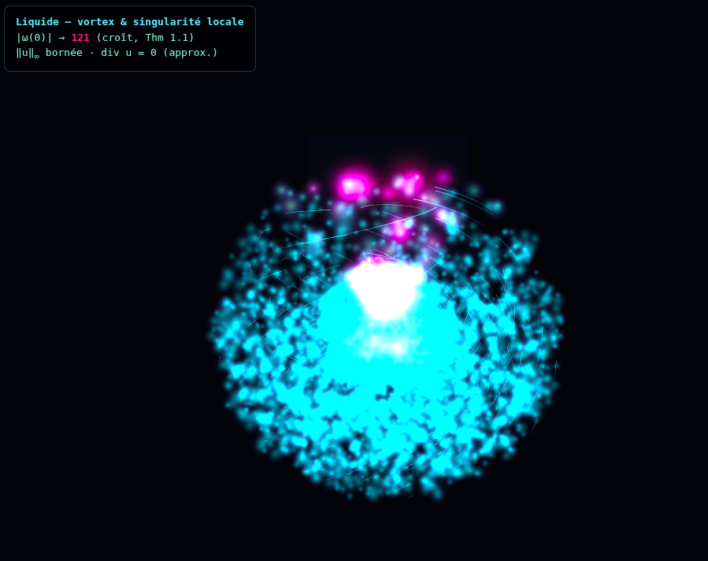
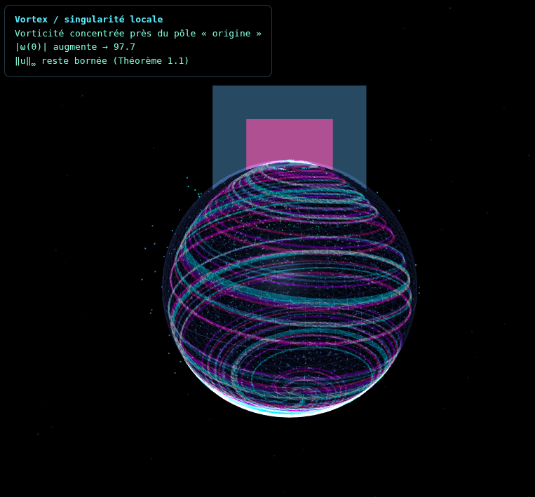
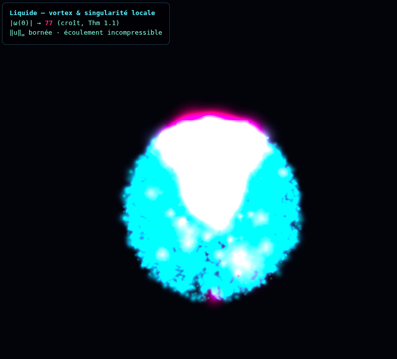
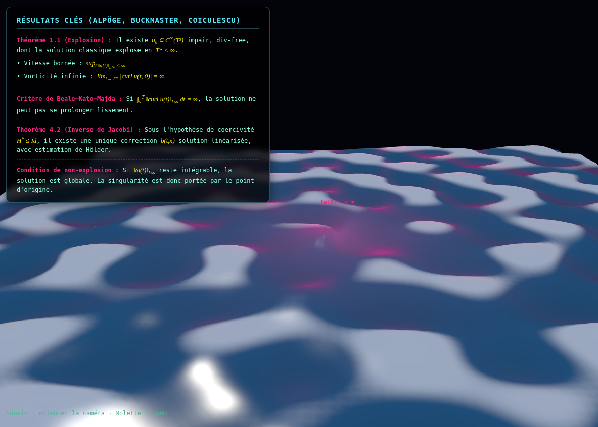

# Finite-Time Singularity Formation for the 3D Euler Equations
# Formation de singularité en temps fini pour les équations d'Euler 3D

**Auteurs du papier / Paper Authors:** Levent Alpöge, Tristan Buckmaster, Matei P. Coiculescu
**Visualisations & Code / Visualizations & Code:** Thibaut Lombard ([Lombard Web Services](https://github.com/Lombard-Web-Services))
**Licence / License:** [MIT](https://opensource.org/licenses/MIT)

---

## 🇫🇷 Français

### À propos
Ce dépôt contient une série de visualisations interactives en 3D (WebGL/Three.js) conçues pour illustrer les résultats du papier de recherche **« Finite-Time Singularity Formation for the Three-Dimensional Euler Equations »** (Alpöge, Buckmaster, Coiculescu). 

Le papier démontre qu'il existe des données initiales lisses pour l'équation d'Euler 3D incompressible (sans force extérieure) dont la solution développe une singularité (explosion) en temps fini : la vorticité tend vers l'infini en un point, tandis que la vitesse reste bornée.

Les visualisations ci-dessous sont des interprétations graphiques pédagogiques. Elles ne sont pas des simulations numériques exactes mais des modèles inspirés des concepts mathématiques du papier (ondes de Craik-Criminale, critère BKM, etc.).

### Visualisations interactives

Cliquez sur les liens ou les images pour lancer les visualisations dans votre navigateur (nécessite WebGL).

---

#### 1. Vortex Local & Singularité (Liquide + lignes de flux)

- **Fichier :** `Vorticité-Particules-lignes-de-flux.html`
- **Description :** Un rendu fluide sous forme de particules et de lignes de courant lisses. Le vortex est concentré près de l'origine (le pôle), illustrant la concentration de vorticité et la croissance de `|ω(0)|` tandis que la vitesse globale reste bornée (Théorème 1.1).

---

#### 2. Vorticité

- **Fichier :** `Vorticité.png.html`
- **Description :** Rendu volumétrique par "raymarching" générant une apparence de fluide dense avec des bandes de vorticité en rotation. La singularité centrale pulse, métaphore visuelle de l'explosion mathématique de la vorticité.

---

#### 3. Liquide & Singularité (Volumétrique)

- **Fichier :** `vortex-et-singularite-locale.html`
- **Description :** Une autre vue du vortex liquide avec advection de particules, mettant en évidence l'attraction vers le pôle (convergence) et la turbulence générée autour de l'axe.

---

#### 4. Vortex sur Sphère (Modèle géométrique)

- **Fichier :** `Vorticité.html`
- **Description :** Visualisation abstraite avec des lignes hélicoïdales enroulées autour d'une sphère, convergeant vers le pôle nord (la singularité). Représente la géométrie des ondes de Craik-Criminale.

---

#### 5. Liquide Rectangulaire & Théorèmes, Résultats clés

- **Fichier :** `resultats_alpoge-buckmaster-coiculescu..html`
- **Description :** Une surface d'eau rectangulaire avec un shader de réflexion/réfraction (simulation de raytracing). Un HUD superposé affiche les théorèmes clés du papier (Théorème 1.1, Critère de Beale-Kato-Majda, Théorème 4.2 sur l'inverse de Jacobi).

---

#### 6. Visualisation des 4 Théorèmes (Split Screen)

- **Fichier :** `theoreme_alpoge-buckmaster-coiculescu.html`
- **Description :** Quatre vues distinctes illustrant chacune un concept mathématique : le puits de singularité (Thm 1.1), le chaos de l'intégrale BKM, la stabilité de l'inverse de Jacobi (Thm 4.2), et le profil de coupure `F_h` (Lemme 3.1).

---

### 🚀 Lancer localement
Aucune installation n'est requise. Ouvrez simplement les fichiers `.html` dans un navigateur moderne (Chrome, Firefox, Edge, Safari) supportant WebGL.

### Crédits
- **Recherche originale :** Levent Alpöge, Tristan Buckmaster, Matei P. Coiculescu.
- **Développement des visualisations :** Thibaut Lombard pour [Lombard Web Services](https://github.com/Lombard-Web-Services).
- **Licence :** MIT.

---

## 🇬🇧 English

### About
This repository contains a series of interactive 3D visualizations (WebGL/Three.js) designed to illustrate the results of the research paper **"Finite-Time Singularity Formation for the Three-Dimensional Euler Equations"** (Alpöge, Buckmaster, Coiculescu).

The paper proves that there exist smooth initial data for the 3D incompressible Euler equations (without external forcing) whose solution develops a singularity (blow-up) in finite time: the vorticity tends to infinity at a point, while the velocity remains bounded.

The visualizations below are pedagogical graphical interpretations. They are not exact numerical simulations but models inspired by the mathematical concepts of the paper (Craik-Criminale waves, BKM criterion, etc.).

### Interactive Visualizations

Click on the links or images to launch the visualizations in your browser (WebGL required).

---

#### 1. Local Vortex & Singularity (Liquid + Streamlines)

- **File:** `Vorticité-Particules-lignes-de-flux.html`
- **Description:** A fluid rendering using particles and smooth streamlines. The vortex is concentrated near the origin (the pole), illustrating vorticity concentration and the growth of `|ω(0)|` while the global velocity remains bounded (Theorem 1.1).

---

#### 2. Animated Volumetric Vortex

- **File:** `vortex-local-singularity.html`
- **Description:** Volumetric raymarching rendering generating a dense fluid appearance with rotating vorticity bands. The central singularity pulses, a visual metaphor for the mathematical blow-up of vorticity.

---

#### 3. Liquid & Singularity (Volumetric)

- **File:** `vortex-et-singularite-locale.html`
- **Description:** Another view of the liquid vortex with particle advection, highlighting the attraction toward the pole (convergence) and the turbulence generated around the axis.

---

#### 4. Vortex on a Sphere (Geometric Model)

- **File:** `Vorticité.html`
- **Description:** Abstract visualization with helical lines wrapped around a sphere, converging toward the north pole (the singularity). Represents the geometry of Craik-Criminale waves.

---

#### 5. Rectangular Liquid & Theorems

- **File:** `resultats_alpoge-buckmaster-coiculescu..html`
- **Description:** A rectangular water surface with a reflection/refraction shader (raytracing simulation). An overlaid HUD displays the paper's key theorems (Theorem 1.1, Beale-Kato-Majda Criterion, Theorem 4.2 on the Jacobi inverse).

---

#### 6. Visualization of the 4 Theorems (Split Screen)

- **File:** `theoreme_alpoge-buckmaster-coiculescu.html`
- **Description:** Four distinct views each illustrating a mathematical concept: the singularity well (Thm 1.1), the chaos of the BKM integral, the stability of the Jacobi inverse (Thm 4.2), and the cutoff profile `F_h` (Lemma 3.1).

---

### 🚀 Run Locally
No installation is required. Simply open the `.html` files in a modern browser (Chrome, Firefox, Edge, Safari) supporting WebGL.

### Credits
- **Original Research:** Levent Alpöge, Tristan Buckmaster, Matei P. Coiculescu.
- **Visualization Development:** Thibaut Lombard for [Lombard Web Services](https://github.com/Lombard-Web-Services).
- **License:** MIT.

---

## License / Licence

MIT License

Copyright (c) 2024 Thibaut Lombard / Lombard Web Services

Permission is hereby granted, free of charge, to any person obtaining a copy
of this software and associated documentation files (the "Software"), to deal
in the Software without restriction, including without limitation the rights
to use, copy, modify, merge, publish, distribute, sublicense, and/or sell
copies of the Software, and to permit persons to whom the Software is
furnished to do so, subject to the following conditions:

The above copyright notice and this permission notice shall be included in all
copies or substantial portions of the Software.

THE SOFTWARE IS PROVIDED "AS IS", WITHOUT WARRANTY OF ANY KIND, EXPRESS OR
IMPLIED, INCLUDING BUT NOT LIMITED TO THE WARRANTIES OF MERCHANTABILITY,
FITNESS FOR A PARTICULAR PURPOSE AND NONINFRINGEMENT. IN NO EVENT SHALL THE
AUTHORS OR COPYRIGHT HOLDERS BE LIABLE FOR ANY CLAIM, DAMAGES OR OTHER
LIABILITY, WHETHER IN AN ACTION OF CONTRACT, TORT OR OTHERWISE, ARISING FROM,
OUT OF OR IN CONNECTION WITH THE SOFTWARE OR THE USE OR OTHER DEALINGS IN THE
SOFTWARE.
